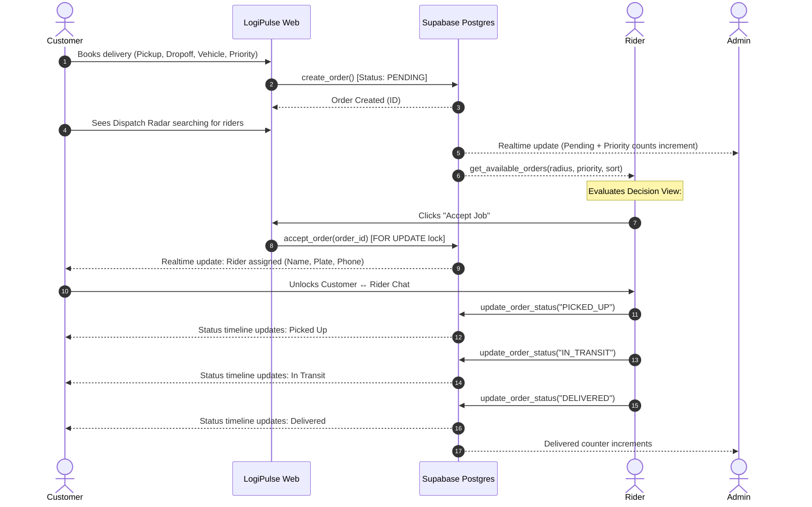

# LogiPulse — Courier & Last-Mile Delivery Platform
> **SENTEC · The Engineer's Code 2025**  
> **Module Brief:** The Web Forces — LogiPulse: Courier & Last-Mile Delivery Platform

LogiPulse is a high-performance, real-time courier platform that connects customers, riders, and dispatch administrators across within-city deliveries. Built with TanStack Start, React 19, TypeScript, Tailwind CSS, Leaflet GIS mapping, and Supabase Postgres with atomic row-level security.

---

## Table of Contents
1. [Project Overview](#project-overview)
2. [Tech Stack](#tech-stack)
3. [Three Dashboard Architecture & Strict RBAC](#three-dashboard-architecture--strict-rbac)
4. [Smart Nearby Pickup (Unique Feature)](#smart-nearby-pickup-unique-feature)
5. [Day 2 Peak Hours: Priority Delivery System](#day-2-peak-hours-priority-delivery-system)
6. [Complete Courier Workflow](#complete-courier-workflow)
7. [Standard Demo Sequence (9 Steps)](#standard-demo-sequence-9-steps)
8. [Standard Judge Q&A Defense Guide](#standard-judge-qa-defense-guide)
9. [How to Run & Deploy](#how-to-run--deploy)

---

## Project Overview

LogiPulse solves the last-mile urban logistics problem by interconnecting three distinct stakeholders in real time:
- **Customers**: Place deliveries, pin precise pickup and drop-off coordinates within service areas, select vehicle class (Bike / Cargo) and urgency priority, track dispatches with an interactive live radar, view rider credentials (name, phone, number plate), and chat directly with their courier.
- **Riders**: Set live GPS coordinates (or select demo benchmark zones), discover pickups ranked by true mathematical Haversine distance, filter dual-criteria (radius + priority), evaluate orders via an explicit decision view (`#Ref · Distance · Priority`), atomically claim deliveries with guaranteed concurrency safety, progress status, and communicate with customers.
- **Administrators**: Oversee platform throughput, track live counts of open orders segmented by priority (`NORMAL`, `HIGH`, `URGENT`), monitor courier fleet status, filter and inspect deliveries, escalate priorities on the fly, and manage user activations.

---

## Tech Stack

- **Frontend & Fullstack Framework**: [TanStack Start](https://tanstack.com/start) (React 19, Vite, Nitro server engine)
- **Routing & State**: [TanStack Router](https://tanstack.com/router) with type-safe search params and route guards, [TanStack Query v5](https://tanstack.com/query) with cache invalidation and optimistic updates
- **Styling & Components**: Tailwind CSS v4, Radix UI primitives, `lucide-react`, `sonner` toasts, Recharts analytics
- **Geographic Information Systems (GIS)**: Leaflet with OpenStreetMap tiles for map selection, interactive bounding circles, and great-circle Haversine computation
- **Backend & Database**: External Supabase (PostgreSQL 15+, Auth, Row-Level Security, RPC `SECURITY DEFINER` functions, Postgres Realtime replication via Phoenix channels)
- **Quality & Assurance**: Vitest unit/integration test suite, TypeScript strict mode with zero compiler errors

---

## Three Dashboard Architecture & Strict RBAC

To preserve real-world system integrity, LogiPulse implements **strict role-based access control (RBAC)** across three non-overlapping dashboard realms:

```text
src/
├── routes/
│   ├── auth.tsx                         <-- Role-intent authentication & registration
│   └── _authenticated/
│       ├── customer.*                   <-- Customer Portal (/customer, /customer/book, /customer/orders)
│       ├── rider.*                      <-- Rider Portal (/rider, /rider/jobs)
│       └── admin.*                      <-- Admin Operations (/admin, /admin/orders, /admin/priority, /admin/riders)
├── features/
│   ├── auth/ (roles.ts, guards)         <-- Strict server & client RBAC validation
│   ├── customer/                        <-- Customer navigation and state
│   ├── rider/                           <-- Rider profile, discovery, and claim logic
│   ├── admin/                           <-- System metrics, priority escalation, user management
│   ├── orders/                          <-- Order lifecycle, pricing calculation, realtime hooks
│   ├── chat/                            <-- In-delivery customer-rider messaging
│   └── locations/                       <-- Haversine great-circle distance engine
└── components/
    ├── layout/ (DashboardShell.tsx)     <-- Shared responsive chrome without scroll artifacts
    ├── shared/ (DispatchRadar, OrderBits, MapPicker, PriorityBadge)
    └── ui/ (Design system tokens and primitives)
```

### Security & Role Boundaries
- **No Client Portal Switching**: Unlike naive prototypes with dev switchers, users cannot hop roles at will. Roles are stored in `public.user_roles` (`admin`, `rider`, `customer`) and verified server-side on route `beforeLoad` and inside Postgres RPC functions.
- **Admin Seeding**: Administrators are not openly registered. The platform includes idempotent SQL seeds ([`sql/0007_admin_seed.sql`](file:///c:/Users/mahme/Desktop/sentec/our-cozy-corner/sql/0007_admin_seed.sql)) establishing `admin@logipulse.pk` (`LogiPulseAdmin2025!`).
- **Database-Level Defense**: All database mutations execute through `SECURITY DEFINER` functions with `search_path = public` where execution is revoked from `anon` and granted exclusively to `authenticated`.

---

## Smart Nearby Pickup (Unique Feature)

The SENTEC brief strictly mandates:
> *"Distance must come from real logic — coordinates and a distance calculation, predefined areas, or another logical implementation — not hard-coded labels."*

LogiPulse computes distances using the **Haversine Great-Circle Formula** on spherical coordinates ($R = 6,371\text{ km}$):

$$\Delta\sigma = 2 \arcsin \left( \sqrt{\sin^2\left(\frac{\Delta\phi}{2}\right) + \cos\phi_1 \cos\phi_2 \sin^2\left(\frac{\Delta\lambda}{2}\right)} \right)$$

$$d = R \cdot \Delta\sigma$$

### Implementation Details:
1. **Database Engine (`public.haversine_km`)**: Evaluated in PostgreSQL for scalable, millisecond-fast spatial queries inside `get_available_orders`.
2. **Client Validation (`src/features/locations/haversine.ts`)**: Re-validated on the client with 100% test coverage in Vitest (`haversine.test.ts`).
3. **Dynamic Filtering**:
   - Radii options: `1 km`, `3 km`, `5 km`, `10 km`, `20 km`.
   - Filters combine with vehicle matching (`BIKE` vs `CARGO`) and Urgency Priority via boolean `AND` logic.
   - GPS acquisition: Native HTML5 `navigator.geolocation` with fallback to predefined Karachi benchmark zones (Saddar, Clifton, Gulshan-e-Iqbal, North Nazimabad).

---

## Day 2 Peak Hours: Priority Delivery System

During peak hours, courier demand surges. LogiPulse introduces a 3-tier Priority Delivery System fully satisfying the 4 Day-2 requirements:

### 1. Priority Display
- Three distinct priority levels: `NORMAL`, `HIGH`, and `URGENT`.
- High and Urgent orders are visually highlighted across dashboards:
  - **URGENT**: Rose alert ring, soft tinted background (`bg-rose-500/[0.04]`), pulsing beacon indicator, and high-visibility priority badge.
  - **HIGH**: Amber alert ring, warning background tint (`bg-amber-500/[0.04]`), and amber arrow badge.
  - **NORMAL**: Slate neutral badge and standard border styling.

### 2. Dual Filtering
- **Riders**: Can filter available pickups by `All`, `Urgent`, `High`, or `Normal`, coupled simultaneously with distance radius.
- **Admins**: Can filter system orders by priority (`All`, `Normal`, `High`, `Urgent`) and status (`Pending`, `Accepted`, `In Transit`, `Delivered`).

### 3. Rider Decision View
Riders are empowered to balance proximity against delivery urgency. Available order cards prominently display the exact decision criteria:
```text
┌─────────────────────────────────────────────────────────────────┐
│ #3FA2C1D0  ·  1.3 km away                        [🔴 URGENT]    │
├─────────────────────────────────────────────────────────────────┤
│ 🏍️  Saddar, Karachi → Clifton Block 2                          │
│     Medicines & confidential legal documents                    │
│                                                                 │
│ 🛡️ Handle with care   ·   posted 2 min ago        [Accept Job]  │
└─────────────────────────────────────────────────────────────────┘
```
- **Sorting Options**: Riders can toggle between **Nearest First** (distance primary, priority secondary) and **Priority First** (Urgent $\to$ High $\to$ Normal primary, distance secondary).

### 4. Admin Live Analytics
The Admin Overview automatically computes and displays live counts of unassigned/open orders by priority:
- Live metric cards: `NORMAL`, `HIGH`, `URGENT` counts with all-time historical totals.
- Instant reactivity: Backed by Supabase Realtime channel subscriptions (`postgres_changes` on `public.orders`).

---

## Complete Courier Workflow



---

## Standard Demo Sequence (9 Steps)

Follow this 3-minute sequence during your competition defense:

| Step | Feature | What to Demonstrate |
| :---: | :--- | :--- |
| **1** | **Login / Roles** | Show `/auth` role-intent page. Explain strict RBAC and demonstrate that customer, rider, and admin credentials route to dedicated portals. |
| **2** | **User Creates Request** | On `/customer/book`, drop pickup and drop-off pins on the Karachi Leaflet map. Select vehicle (`Bike`), choose **`URGENT`** priority, and confirm. |
| **3** | **Rider Finds Request** | Open Rider Dashboard (`/rider`). Show current location in Saddar and observe the newly placed order appearing in the list. |
| **4** | **Smart Nearby Pickup** | Point out the calculated straight-line distance (`1.3 km away`) derived dynamically via the Haversine formula from rider GPS to pickup pin. |
| **5** | **Rider Accepts Order** | Click "Accept Job". Highlight the atomic transaction locking out duplicate accepts and transitioning status to `ACCEPTED`. |
| **6** | **User ↔ Rider Chat** | Show customer order screen: the interactive Dispatch Radar transitions to reveal rider info (Plate `KHI-8492`, Name, Phone). Type and exchange live messages in chat. |
| **7** | **Status Transitions** | Rider advances order: `Picked Up` $\to$ `In Transit` $\to$ `Delivered`. Customer timeline and progress bar update reactively. |
| **8** | **Admin Dashboard** | Navigate to `/admin`. Highlight live platform telemetry: Active Deliveries, Completed Orders, and Orders per Day chart. |
| **9** | **Day 2 Priority Feature** | Demonstrate: (a) Highlighted Urgent/High cards, (b) Rider sorting by "Priority First", (c) Rider & Admin priority filters, (d) Admin live priority counts (`NORMAL`, `HIGH`, `URGENT`), and (e) Admin priority escalation board (`/admin/priority`). |

---

## Standard Judge Q&A Defense Guide

### Q1: "How does data created on the User Dashboard become available on the Rider Dashboard?"
> **Answer**:  
> When a customer books a delivery, the client invokes the PostgreSQL function `public.create_order()`, inserting an immutable row into `public.orders` with status `PENDING` and coordinates `(pickup_lat, pickup_lng)`.  
> The Rider Dashboard subscribes to PostgreSQL CDC (Change Data Capture) via Supabase Realtime WebSocket channels (`supabase.channel('orders-realtime')` listening to `postgres_changes` on table `orders`). Upon any insert or update, TanStack Query immediately invalidates query key `['rider', 'available']`, triggering `public.get_available_orders()` to re-fetch and re-rank candidate pickups matching the rider's coordinates and vehicle.

### Q2: "What happens if two riders try to accept the same order?"
> **Answer**:  
> Concurrency is solved at the database engine level inside `public.accept_order(p_order_id)`.  
> 1. It executes `SELECT * FROM public.orders WHERE id = p_order_id FOR UPDATE`, which acquires an exclusive row-level lock on that specific record.  
> 2. The second rider's transaction blocks until the first completes.  
> 3. Once unlocked, the second transaction evaluates `IF o.status <> 'PENDING' OR o.rider_id IS NOT NULL` and aborts with exception `'This order is no longer available'` (SQLSTATE `22023`).  
> 4. Additionally, a rider check `WHERE rider_id = r.user_id AND status IN ('ACCEPTED', 'PICKED_UP', 'IN_TRANSIT')` enforces the business invariant that no courier can juggle multiple concurrent deliveries.

### Q3: "How are you calculating or determining the nearest pickup?"
> **Answer**:  
> We compute straight-line distances using the spherical Haversine formula directly in PostgreSQL via `public.haversine_km(lat1, lng1, lat2, lng2)` with Earth's radius $R = 6,371\text{ km}$.  
> In `get_available_orders`, every pending order within the rider's selected radius parameter (`p_radius_km`) has its distance computed dynamically on the fly. The results are ordered by `c.d` (distance) when sorted by nearest, or by priority rank then distance when sorted by priority. Distances are never hardcoded or pre-baked.

### Q4: "How do changes in order status propagate between dashboards?"
> **Answer**:  
> Status updates flow through the audited function `public.update_order_status()`, which appends a timestamped record to `public.order_status_events` and updates `public.orders`.  
> Both the customer order tracking view (`/customer/orders/$orderId`) and the Admin overview maintain real-time Supabase replication subscriptions. As soon as the rider toggles `PICKED_UP` or `IN_TRANSIT`, the client receives the payload and invalidates the respective TanStack Query cache, causing the progress bar, timeline steps, and radar to update without a manual page refresh.

### Q5: "How did you modify your original architecture to support priority orders?"
> **Answer**:  
> We introduced a first-class database enum `public.order_priority ('NORMAL', 'HIGH', 'URGENT')` and added a `priority` column indexed on `public.orders`.  
> We then modified:
> 1. `create_order()` to accept `p_priority` from the booking form.
> 2. `get_available_orders()` with parameter `p_priority` and dual-mode sorting (`p_sort: 'nearest' | 'priority'`).
> 3. `admin_stats()` to aggregate live counts (`open_normal`, `open_high`, `open_urgent`).
> 4. Frontend order cards with visual highlight rings (`border-rose-500`, pulsating beacons), priority chips, and an Admin Priority Escalation view (`/admin/priority`).

### Q6: "If LogiPulse had 10,000 riders, what would you change in your current solution?"
> **Answer**:  
> At 10,000 riders:
> 1. **Spatial Indexing with PostGIS**: Migrate raw `haversine_km` SQL math to PostGIS geography columns using GiST indexes (`ST_DWithin` and `<->` distance operator) for sub-millisecond bounding-box filtering across hundreds of thousands of rows.
> 2. **Rider Geolocation Ingestion**: Offload rider GPS heartbeats from Postgres writes into an in-memory Redis cluster with Redis Geospatial indexes (`GEOADD`, `GEORADIUS`), debouncing writes to the primary database.
> 3. **Message Queue Dispatch**: Decouple order matching via an asynchronous queue (RabbitMQ/BullMQ) with localized geohash clustering instead of riders pulling full table queries.
> 4. **Supabase Realtime Partitioning**: Scope WebSocket topics by geohash/cell clusters so riders only receive event notifications for their immediate 5–10 km sector.

---

## How to Run & Deploy

### Prerequisites
- Node.js 20+ or Bun 1.1+
- An external [Supabase](https://supabase.com) project

### 1. Installation
```bash
npm install
```

### 2. Environment Configuration
Create `.env` based on `.env.example`:
```env
VITE_SUPABASE_URL=https://your-project.supabase.co
VITE_SUPABASE_ANON_KEY=your-publishable-anon-key
```

### 3. Database Migration & Seeds
Run the following SQL scripts in your Supabase SQL Editor in numerical order:
1. `supabase/migrations/20261001000002_logipulse_core_idempotent.sql` (Core tables, RLS, Haversine, RPCs)
2. `sql/0007_admin_seed.sql` (Creates default admin: `admin@logipulse.pk` / `LogiPulseAdmin2025!`)
3. `sql/0008_rider_details_and_chat_fix.sql` (Rider vehicle plate number, phone, and chat RLS)
4. `sql/0009_priority_booking_and_admin_seed.sql` (Day 2 Priority booking support & updated RPCs)

### 4. Run Development Server
```bash
npm run dev
```
The application will be live at `http://localhost:8080`.

### 5. Run Test Suite
```bash
npm run test
```
All 11 unit & integration tests will run with Vitest.

### 6. Production Build
```bash
npm run build
```
Creates an optimized Nitro production bundle ready for Vercel, Netlify, or Cloudflare Pages.
